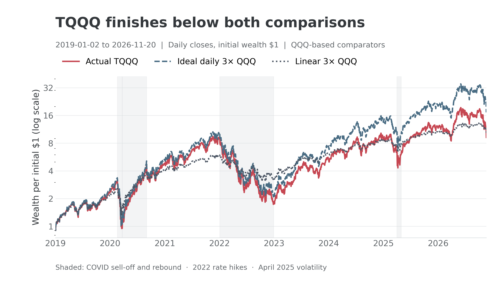
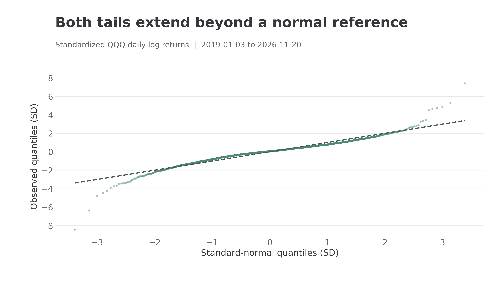

# 2. Daily-reset valuation and historical risk

**Part 2 scope.** Daily leveraged valuation, historical path attribution, and long/short exposure mapping.

### 中文摘要

本节沿用 Part 1 的共同交易日与复权收盘价。QQQ 两日涨跌相抵时，理想每日 3 倍路径仍损失 5.45%。历史区间内，TQQQ 最大回撤为 −81.66%，QQQ 为 −35.12%。在 QQQ 近乎横盘的等长窗口中，高波动组的重置差额中位数为 −1.24 个百分点，低波动组为 −0.52 个百分点。多日 VaR 和 ES 应在标的路径逐日重估后，按多空头寸分别度量。

## 2.1 Data and instrument mapping

Use the frozen **1,983 common daily returns** from **3 Jan 2019 to 20 Nov 2026** with $1.00 anchored at the 2 Jan 2019 close. QQQ, TQQQ and SQQQ are measured with adjusted market closes. The Nasdaq-100 price index (NDX) is TQQQ’s formal daily benchmark, and QQQ is the investable comparator. Annualized volatility uses the sample standard deviation times $\sqrt{252}$; rolling comparisons use trailing 21 and 63 trading days. Drawdown is wealth divided by the running peak minus one.

| Observed sample metric | QQQ | TQQQ | SQQQ |
|:---|---:|---:|---:|
| Cumulative return | 311.88% | 823.07% | −99.82% |
| Geometric annual return | 19.71% | 32.64% | −55.13% |
| Annualized volatility | 24.09% | 71.27% | 71.49% |
| Maximum drawdown | −35.12% | −81.66% | −99.91% |

## 2.2 One-day replication and full revaluation

In a stylized funded replication at a reset close, hold $3V_{t-1}$ of benchmark exposure funded by $V_{t-1}$ of equity and $2V_{t-1}$ of borrowing. If the benchmark simple return is $r_t$, the daily funding rate is $f_t$, and additional expense per initial NAV dollar is $c_t$, the next-close value before applying any NAV floor is

$$V_t=V_{t-1}\big[3(1+r_t)-2(1+f_t)-c_t\big].$$

This is a valuation bridge for the exposure. The issued ETF can obtain exposure through derivatives and the observed adjusted market price can deviate from its ideal path. Set $f_t=c_t=0$ for ideal wealth $W_D=\prod_t(1+3r_t)$. Compare it with the hypothetical linear multiple $W_H=1+3(W_B-1)$, where $W_B=\prod_t(1+r_t)$, and observed $W_A$. For example, +10.00% followed by −9.09% leaves QQQ flat when the second move is exactly $-1/11$. The ideal path ends at $1.30(1-3/11)\approx 0.9455$, a **5.45%** loss. For positive paths, the exact log gap $\log W_D-3\log W_B$ is the sum of $\log(1+3r_t)-3\log(1+r_t)$ and is approximately $-3\sum_t r_t^2$ to second order (RMSC 5003 Chs. 4–5; Avellaneda & Zhang; Jarrow).

## 2.3 The observed fund lagged both full-sample 3× comparisons

| Benchmark basis | Ideal daily 3× | Linear 3× | Actual TQQQ | Ideal − linear | Actual − ideal |
|:---|---:|---:|---:|---:|---:|
| QQQ proxy | 1,626.69% | 935.65% | 823.07% | 691.04 pp | −803.62 pp |
| NDX index | 1,358.94% | 880.45% | 823.07% | 478.49 pp | −535.87 pp |

Return gaps are in percentage points (pp). On the formal NDX basis, daily compounding added **478.49 pp** over the linear comparison, and the actual fund lagged the ideal by **535.87 pp**. The expense sensitivity applies the disclosed 0.78% net annual rate as a constant expense scenario, using 252 trading days. Financing, trading and market-price effects remain in the residual. Annualized daily tracking-error SD is 3.83% on NDX and 3.21% on QQQ.

{width=5.9in}

| QQQ-based stress episode | Days | QQQ | Actual TQQQ | Ideal daily 3× | Reset gap |
|:---|---:|---:|---:|---:|---:|
| COVID sell−off | 23 | −27.92% | −69.83% | −69.46% | 14.29 pp |
| COVID rebound | 114 | 77.92% | 389.98% | 398.63% | 164.86 pp |
| 2022 rate hikes | 250 | −33.22% | −79.68% | −78.22% | 21.44 pp |
| April 2025 reversals | 21 | 1.40% | −4.22% | −3.38% | −7.57 pp |

With 94 disjoint 21-day blocks, the 34 near-flat observations (QQQ within ±3%) had median reset gaps of **−0.52 pp** below the 18.87% annualized RMS split ($n=20$) and **−1.24 pp** at or above it ($n=14$). The grouping uses completed windows. The rebound and April comparison shows how trend can offset the volatility penalty in arithmetic returns.

## 2.4 From position valuation to tail risk

With initial exposure $K$ and terminal wealth ratio $W$, positive losses are $K(1-W)$ for a fixed-share long and $K(W-1)$ for a fixed-share short. The worst historical short P&L was **−$18.46 per initial $1** before borrow costs. SQQQ resets its own negative exposure, so it creates a different payoff. Drawdown measures a realized peak-to-trough fall. The historical short mark measures P&L relative to entry.

For Part 3, estimate conditional dynamics on the canonical QQQ log returns. Before choosing an innovation law, check fitted standardized residuals; the observed unconditional excess kurtosis of 7.10 is a diagnostic input. Convert each modeled log return to a simple return and apply the daily mapping at every step. Part 4 can use the resulting position losses to compute VaR and ES at each approved confidence and 1-, 10- and 21-day horizon. Part 5 evaluates forecasts and proposes limits. This follows the course’s exposure mapping, simulation, estimation and loss-based risk measure sequence.

{width=4.65in}

### Sources for this section

RMSC 5003 *Risk Measures*: Ch. 4 (exposure mapping, pp. 2–10); Ch. 5 (full revaluation and stress, pp. 39–44, 56–57); Ch. 6 (VaR/ES, pp. 13–14, 28–30); Ch. 7 (dynamic volatility and simulation, pp. 52–60, 82–95); Ch. 8 (parameter estimation and diagnostics, pp. 10–20).

- Avellaneda & Zhang (2010), *SIAM Journal on Financial Mathematics*. [doi:10.1137/090760805](https://doi.org/10.1137/090760805)
- Jarrow (2010), *Finance Research Letters*. [doi:10.1016/j.frl.2010.04.001](https://doi.org/10.1016/j.frl.2010.04.001)
- Charupat & Miu (2011), *Journal of Banking & Finance*. [doi:10.1016/j.jbankfin.2010.09.012](https://doi.org/10.1016/j.jbankfin.2010.09.012)
- Tang & Xu (2013), *Journal of Financial and Quantitative Analysis*. [doi:10.1017/S0022109012000622](https://doi.org/10.1017/S0022109012000622)
- Wagalath (2014), *Quantitative Finance*. [doi:10.1080/14697688.2014.916817](https://doi.org/10.1080/14697688.2014.916817)
- Charupat & Miu (2014), *Financial Review*. [doi:10.1111/fire.12055](https://doi.org/10.1111/fire.12055)
- Loviscek, Tang & Xu (2014), *Journal of Banking & Finance*. [doi:10.1016/j.jbankfin.2014.02.008](https://doi.org/10.1016/j.jbankfin.2014.02.008)
- Bansal & Marshall (2015), *Global Finance Journal*. [doi:10.1016/j.gfj.2015.11.006](https://doi.org/10.1016/j.gfj.2015.11.006)
- Giannetti (2017), *Quantitative Finance*. [doi:10.1080/14697688.2016.1237035](https://doi.org/10.1080/14697688.2016.1237035)
- Miu, Yueh & Han (2021), *Pacific-Basin Finance Journal*. [doi:10.1016/j.pacfin.2020.101490](https://doi.org/10.1016/j.pacfin.2020.101490)
